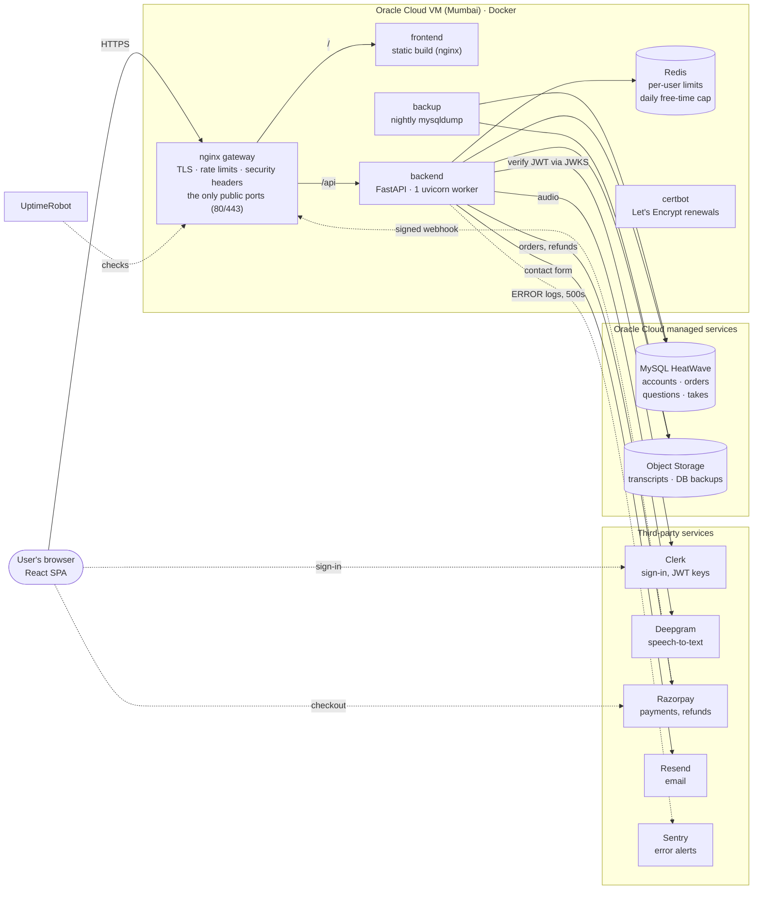
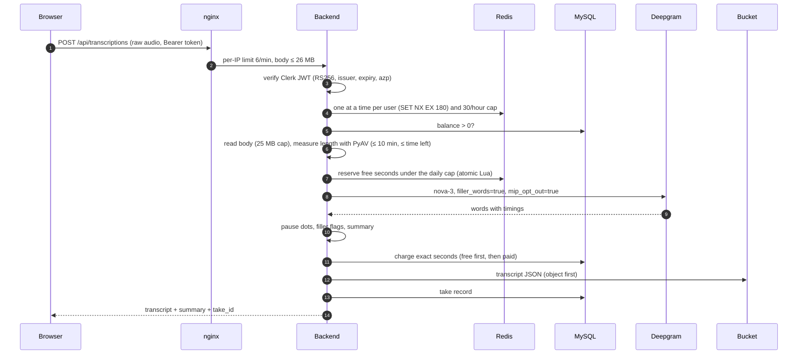
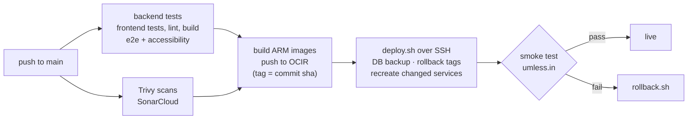

# umless

**Say less um.** A speech-practice web app: keep a list of practice questions, record a spoken answer in the browser, and get a transcript that deliberately **keeps every "um", "uh" and "mhmm"** and marks pauses of a second or more as dots, with your pace, filler rate and longest pause. Replay and download the audio and a `.txt` transcript.

Live at **https://umless.in**.

- **Frontend:** React 19 + TypeScript + Vite, in `frontend/`
- **Backend:** FastAPI (Python 3.12), in `backend/`
- **Deployment:** Docker containers behind an nginx gateway on one Oracle Cloud VM, in `deploy/`

Locally it runs as a single user with a JSON file and no external services. The deployed site adds Clerk sign-in, MySQL, object storage for transcripts, Redis limits and Razorpay payments.

## Contents

- [Features](#features)
- [Architecture](#architecture)
- [How a transcription works](#how-a-transcription-works)
- [Tech stack](#tech-stack)
- [Repository layout](#repository-layout)
- [Key design decisions](#key-design-decisions)
- [Security](#security)
- [Operations: logging, monitoring, backups](#operations-logging-monitoring-backups)
- [Local setup](#local-setup)
- [Tests](#tests)
- [CI/CD and deploys](#cicd-and-deploys)
- [Deploy configuration](#deploy-configuration)
- [Manual microphone checklist](#manual-microphone-checklist)
- [Documentation map](#documentation-map)
- [Known limitations](#known-limitations)

## Features

- **Questions:** an ordered list per user (add, edit, reorder, delete).
- **Practice:** record up to 10 minutes in the browser, or up to the practice time left if that's shorter, with a live timer, level meter and a final-minute countdown.
- **Transcript that keeps fillers:** Deepgram nova-3 with filler words on. Pauses of 1 s or more become `·` dots (one per full second).
- **Summary per take:** word count, fillers by word, words per minute, fillers per minute, pause count, longest pause.
- **History and dashboard:** past takes per question and across questions, with trends.
- **Accounts:** sign-in with Clerk (email or Google).
- **Practice time:** free minutes for every new account, then packs paid through Razorpay. Charged by the second, never expires. Self-serve refunds for unused packs.
- **Privacy:** the audio is never stored on the server. Transcripts are saved per user, and logs never contain transcript text.

## Architecture



- **Only nginx is reachable from the internet.** The backend, Redis and backup containers sit on an internal Docker network.
- **The backend accepts only `Host: localhost`.** This guards against DNS rebinding, and nginx vouches for real requests.
- **The browser talks to Clerk and Razorpay directly** for sign-in and checkout. The backend verifies the results: Clerk's RS256 JWTs, and Razorpay's HMAC signatures plus an API check.
- **Transcripts live in the bucket** (`users/<user_id>/takes/<take_id>.json`). MySQL holds the summaries. Audio is never stored.

## How a transcription works

Everything that can refuse a request happens **before** the paid Deepgram call. The user is charged the exact measured length **after** it succeeds.



Failures degrade gracefully:
- **Deepgram fails:** the user gets 502 with "try again", the recording stays in the tab, and reserved free seconds are returned.
- **Storage fails:** the transcript is still returned, with `take_id: null`.
- **Charging fails:** it's logged, and the user keeps the transcript.

## Tech stack

| Area | Technology |
|---|---|
| Frontend | React 19, TypeScript, Vite 6, TanStack Query, openapi-fetch (generated types), plain CSS with design tokens, self-hosted fonts |
| Backend | Python 3.12, FastAPI / Starlette, Uvicorn, Pydantic, SQLAlchemy Core, Alembic, PyJWT, httpx, PyAV (FFmpeg), redis-py, OCI SDK, sentry-sdk |
| Data | MySQL HeatWave (Oracle, Always Free), Oracle Object Storage, Redis 7 |
| Services | Clerk (auth), Deepgram (speech-to-text), Razorpay (payments), Resend (email), Sentry (errors), UptimeRobot (uptime), Let's Encrypt (TLS) |
| Infrastructure | Docker + Compose, nginx, Oracle Cloud ARM VM, OCIR (image registry), cron |
| Quality | pytest, Schemathesis, Vitest + Testing Library, Playwright + axe-core, ESLint, Trivy, SonarCloud, pip-audit / npm audit |
| CI/CD | GitHub Actions: test, scan, build ARM images, deploy over SSH, smoke test, automatic rollback |

## Repository layout

```
backend/            FastAPI app (app/), Alembic migrations, pytest suite
  app/auth.py         Clerk JWT verification
  app/errors.py       ApiError, the shared error body, Host guard
  app/log.py          non-blocking queue logging
  app/monitoring.py   Sentry setup and scrubbing
  app/limits.py       per-user lock and hourly cap (Redis or memory)
  app/free_cap.py     site-wide daily cap on free minutes
  app/questions/      questions (MySQL or JSON file)
  app/transcription/  Deepgram client, fake transcriber, audio measuring, router
  app/takes/          saved takes (MySQL records + bucket transcripts)
  app/billing/        prices, balances, orders, Razorpay, refunds, webhook
  app/contact/        contact form via Resend
  app/client_errors/  browser crash and CSP reports
frontend/           React app
  src/app/            shell, routes, session
  src/pages/          one thin component per route
  src/features/       questions, practice, takes, progress, history, billing, marketing, legal
  src/shared/         API client (generated types), UI primitives, theme, utilities
  src/content/        copy and prices as data
  tests/e2e/          Playwright flows and accessibility
deploy/             nginx gateway, compose, deploy/rollback scripts, watchdog
redis/  backup/     Redis service; nightly MySQL dumps and restore test
docs/               PRD, ADRs, OpenAPI contract, runbooks, design, roadmaps
```

## Key design decisions

The reasons are recorded as ADRs in [`docs/adr/`](docs/adr/).

- **Contract first:** [`docs/api/openapi.yaml`](docs/api/openapi.yaml) is the source of truth. The frontend's types are generated from it (`npm run gen:api`), and Schemathesis fuzzes every endpoint against it in CI.
- **One error body:** every non-2xx response is `{code, detail, fields?}` with a stable `code`.
- **Auth delegated to Clerk:** the backend only verifies tokens, and every endpoint except `/api/health` requires one. Every row is owned by the Clerk user id, and another user's resource looks like a 404 ([ADR 0003](docs/adr/0003-clerk-auth.md)).
- **Metered by the second:** the server measures each recording before paying Deepgram. Crediting is idempotent through an order status machine (`created → paid → refund_pending → refunded`) ([ADR 0004](docs/adr/0004-razorpay-billing.md)).
- **Limits in Redis that fail open:** an outage shouldn't stop people practising, and billing stays correct in MySQL ([ADR 0006](docs/adr/0006-redis-limits.md)).
- **Configuration fails closed:** a server with a database refuses to start without sign-in, payments, the bucket and Redis.
- **Layered frontend:** `app → pages → features → shared`, with ESLint enforcing the import direction. Only `*Api.ts` modules call the API ([ADR 0005](docs/adr/0005-frontend-v2-architecture.md)).

## Security

- **Tokens:** Clerk JWTs are verified on every request, with RS256 pinned, issuer, expiry and authorized-party checks.
- **Data isolation:** every query is scoped by the user id, and all SQL goes through SQLAlchemy Core with no string-built SQL.
- **Cross-site requests:** there's no CORS, writes are JSON-only, and the backend accepts only a localhost Host header.
- **Headers:** nginx sends HSTS, `X-Frame-Options`, `nosniff`, Referrer-Policy and Permissions-Policy (microphone for this site only), plus a Content-Security-Policy, currently Report-Only while it's tuned.
- **Payments:** prices come from the server only, and Razorpay signatures are checked with constant-time comparison.
- **Containers and dependencies:** containers run as non-root and only the gateway publishes ports. Trivy scans the code and images in CI.
- **Secrets:** they stay in git-ignored `.env` files and are never logged or sent to Sentry. Sentry gets no bodies, cookies, tokens, frame variables or IPs.

## Operations: logging, monitoring, backups

| Concern | How |
|---|---|
| Logging | Queue-based, so log calls never block a request. Output goes to stdout and is rotated by Docker. Logs never include transcript text or keys, and request-supplied values are escaped with `%r`. **ERROR means a human should act.** |
| Errors | Sentry, off unless `SENTRY_DSN` is set. It captures every ERROR log line, unhandled 500s and 5xx API errors. The browser sends crashes and CSP violations to `POST /api/client-errors`, never to a third party. |
| Uptime | UptimeRobot checks `https://umless.in/` and `/api/health` from outside. |
| Server health | [`deploy/watchdog.sh`](deploy/watchdog.sh) runs from cron every 10 minutes. It emails when the disk is over 80%, a container is down or unhealthy, or the health check fails. |
| Backups | A nightly gzipped `mysqldump` goes to a private bucket, kept for 30 days with the newest 7 never deleted. The restore is tested with `backup/restore-test.sh`. |
| Runbooks | [monitoring](docs/runbooks/monitoring.md) · [deploys](docs/runbooks/deploys.md) · [backups](docs/runbooks/backups.md) · [disaster recovery](docs/runbooks/disaster-recovery.md) · [refunds](docs/runbooks/refunds.md) · [launch offer](docs/runbooks/launch-offer.md) |

## Local setup

1. Put your Deepgram key in a git-ignored env file, either `backend/.env` or `.env` in the repo root (see `backend/.env.example`):
   ```
   DEEPGRAM_API_KEY=your-key
   ```
   - To run without a key, set `UMLESS_TRANSCRIBER=fake` instead. You get a canned transcript at no cost.
   - Questions are saved to `backend/data/questions.json`. Set `UMLESS_DATA_FILE` to use another file.
   - To store them in MySQL instead, as the deployed site does:
     - set `DB_HOST`, `DB_PORT`, `DB_USER`, `DB_PASSWORD` and `DB_NAME`, then run `alembic upgrade head` from `backend/`;
     - MySQL needs sign-in too, so set `CLERK_PUBLISHABLE_KEY` and `CLERK_AUTHORIZED_PARTIES` in `backend/.env`, and `VITE_CLERK_PUBLISHABLE_KEY` in `frontend/.env` (see the `.env.example` files).
2. Backend (Windows PowerShell):
   ```powershell
   cd backend
   python -m venv .venv
   .venv\Scripts\python -m pip install -r requirements-dev.txt
   ```
3. Frontend:
   ```powershell
   cd frontend
   npm install
   ```

Run them in two terminals:

```powershell
cd backend; .venv\Scripts\python run.py
```

```powershell
cd frontend; npm run dev
```

Open http://localhost:5173. The dev server forwards `/api` to the backend on 127.0.0.1:8000.

From WSL, call the Windows venv's Python: `cd /mnt/d/umless/backend && .venv/Scripts/python.exe run.py`.

## Tests

```powershell
cd backend; .venv\Scripts\python -m pytest -q
cd frontend; npm test; npm run build; npm run lint
cd frontend; npm run e2e
```

- **Backend:** about 700 tests, covering units, the API, the Schemathesis contract fuzzing, and MySQL and Redis integration.
  - The MySQL tests run when `UMLESS_TEST_DATABASE_URL` names a throwaway database. They drop its tables. Otherwise they're skipped.
  - The Redis tests run when `UMLESS_TEST_REDIS_URL` is set.
  - `pytest --run-live` also makes one real Deepgram call.
  - The test suite never reports to Sentry, even if `backend/.env` has a `SENTRY_DSN`.
- **Frontend:** about 520 unit tests.
- **End to end:** Playwright runs flows F1–F4 and a WCAG 2.2 AA accessibility check on every page.

## CI/CD and deploys



The server never builds code and refuses a dirty checkout. Database migrations run when the backend starts, and a failed migration stops the container instead of serving an old schema. See [`docs/runbooks/deploys.md`](docs/runbooks/deploys.md).

## Deploy configuration

### Bucket access

The backend reaches the OCI bucket as its VM (instance principal), so there are no storage keys. In the OCI console:

1. Identity → Domains → Default → Dynamic groups → create `umless-vm` with the rule `instance.id = '<the VM's OCID>'`.
2. Identity → Policies (root compartment) → create a policy:
   ```
   Allow dynamic-group umless-vm to manage objects in tenancy where target.bucket.name='<transcripts bucket>'
   ```
3. Set `OCI_NAMESPACE`, `OCI_BUCKET` and `OCI_REGION` in `backend/.env`, then recreate the backend. Policies take a minute or two to apply.

### Payments (Razorpay)

New accounts get free minutes, then buy packs. Prices and free time live in `backend/app/billing/packs.py`, with the wording in `frontend/src/content/business.ts`, and the two must change together.

1. Put `RAZORPAY_KEY_ID` and `RAZORPAY_KEY_SECRET` in `backend/.env`. Use test keys (`rzp_test_…`) until going live.
2. In the Razorpay dashboard, go to Webhooks → Add:
   - URL `https://umless.in/api/payments/webhook`;
   - events `payment.captured`, `order.paid`, `refund.processed` and `refund.failed`;
   - a secret, which you also put in `RAZORPAY_WEBHOOK_SECRET`.
3. Recreate the backend. Test with Razorpay's test cards or UPI `success@razorpay`.

### Monitoring

Set `SENTRY_DSN` in `backend/.env`, and install the watchdog cron line from [`docs/runbooks/monitoring.md`](docs/runbooks/monitoring.md).

## Manual microphone checklist

Automated tests use a fake recorder, so the real microphone path is checked by hand in Chrome, and in Firefox and Safari if available. Record the result per browser as pass, fail or "not verified".

1. Click **Start recording** and allow the microphone.
2. Record about 15 seconds, saying "um" and "uh" on purpose.
3. Click **Stop recording**: the browser's microphone indicator turns off.
4. The audio player plays the recording back.
5. Click **Transcribe**: the transcript shows the "um" and "uh".
6. **Download transcript** and **Download audio** both save files that open.
7. Block the microphone in site settings and click **Start recording**: an error is shown, not a blank screen.
8. Click **Start recording** then **Stop recording** immediately: **Transcribe** is disabled with "Recording is empty", or the transcript is empty; never a server error.

## Documentation map

| Need | Read |
|---|---|
| Requirements | [`docs/prd.md`](docs/prd.md) |
| API contract | [`docs/api/openapi.yaml`](docs/api/openapi.yaml) |
| Architecture decisions | [`docs/adr/`](docs/adr/) |
| Build status and decisions log | [`docs/BUILD.md`](docs/BUILD.md) |
| Screens, flows, design tokens | [`docs/design/`](docs/design/) |
| Operations | [`docs/runbooks/`](docs/runbooks/) |
| Roadmaps | [`docs/roadmap/`](docs/roadmap/) |
| Working on the code (conventions, commands, rules) | [`CLAUDE.md`](CLAUDE.md) |

## Known limitations

- **Account deletion is handled by email request** for now. A Clerk `user.deleted` webhook is planned.
- **One VM and one backend worker.** The locks are already in Redis, so scaling out is possible.
- **The Content-Security-Policy is Report-Only** until real use shows no violations.
- **Recordings aren't stored on the server,** so refreshing the page loses an untranscribed recording. Recordings are capped at 10 minutes and 25 MB.
- **Chrome's WebM recordings have no duration metadata,** so the UI shows the measured length instead.
- **Firefox and Safari have had less testing** than Chrome.
