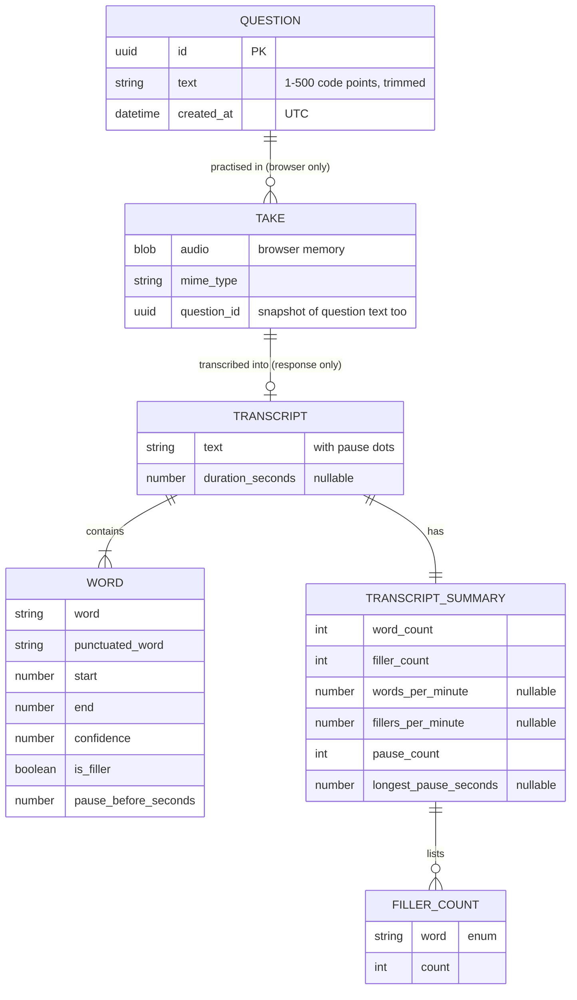

# umless: data model (v1)

v1 has one persisted entity, `Question`, kept in a JSON file on the backend. Everything about a take (the recording, the transcript and its summary) is transient: it exists only in the API response and in browser memory, and is gone on refresh.



## Question (persisted)

| Field | Type | Constraints | Set by |
|---|---|---|---|
| `id` | UUID v4 string | primary key, unique, immutable | server on create |
| `text` | string | after trimming leading/trailing whitespace: 1–500 Unicode code points; request value also limited to 500 code points before trimming; internal whitespace kept as typed; duplicates allowed | client on create/update |
| `created_at` | RFC 3339 date-time, UTC with `Z` | immutable | server on create |

**Order.** The list has an explicit order: the order of the array in the file. New questions are appended. `POST /api/questions` with `position` inserts at that 0-based index (clamped to the list length), which is how Undo puts a deleted question back. There is no stored `position` field; the index is the position. Re-created questions get a new `id` and `created_at`.

**Length.** Python's `len()` (code points) is the authority. The frontend counter must count code points (`[...text].length`), not UTF-16 units, or emoji would count twice.

**Duplicates** are detected only by the client (case-insensitive, whitespace collapsed) to show a warning; the server never rejects them.

### Storage

- File: `backend/data/questions.json` (already git-ignored), path overridable with `UMLESS_DATA_FILE`. Created on the first write; a missing file means an empty list.
- Format:
  ```json
  {
    "version": 1,
    "questions": [
      {"id": "3f2c8a9e-6b1d-4c0e-9a57-2d8e1f4b7c10", "text": "Tell me about yourself", "created_at": "2026-10-19T10:15:02Z"}
    ]
  }
  ```
- Access goes through a `QuestionRepository` Protocol (`list`, `get`, `add(text, position=None)`, `update(id, text)`, `delete(id)`). v1 implementation: `JsonFileQuestionRepository`, loaded once at startup, every mutation under a `threading.Lock`, written through a temp file plus `os.replace` with up to 5 retries on Windows `PermissionError`.
- **Indexes:** none on disk. In memory the repository keeps the ordered list plus a dict from `id` to question for O(1) `get`, `update` and `delete`.
- A file that exists but can't be parsed, or has an unknown `version`, stops startup with a clear error naming the file. The app never overwrites it, so a hand-edited or corrupted list isn't lost.
- **MySQL (deployed site):** when `DB_HOST` is set, questions live in MySQL instead (`app/questions/sql.py`, schema from the Alembic migrations in `backend/migrations/`). Table `questions`: `id` CHAR(36) primary key, `user_id` VARCHAR(255), `position` INT (0-based, kept dense per user), `text` VARCHAR(500), `created_at` DATETIME (UTC); index on (`user_id`, `position`); `utf8mb4_bin` collation so ids compare exactly. Each user has their own list, keyed by their Clerk user id (`docs/adr/0003-clerk-auth.md`); another user's id behaves like a missing one (404). Without sign-in (local use) every request is user `local`. It passes the same repository contract tests as the JSON file.

### Who reads and writes it

| Screen / action | Operation | Access |
|---|---|---|
| `questions`, `questions-loading`, `questions-error` → list / retry | `listQuestions` | read all |
| `questions`, `questions-deleted` → start practice; `practice-ready` (direct URL, refresh, "2 of 5"); `result` → next question | `listQuestions` | read all, then find by id |
| `questions`, `questions-empty`, `questions-invalid` → create, add suggested, add anyway, retry save | `createQuestion` | append |
| `questions-deleted` → undo delete | `createQuestion` with `position` | insert at index |
| `questions` (edit mode) → update question | `updateQuestion` | update `text` |
| `delete-confirm` → delete question | `deleteQuestion` | remove |

## Transient entities (never stored on the server)

### Take (browser only)

The recording a user made in one attempt: an audio `Blob`, its MIME type (`audio/webm;codecs=opus` in Chrome, `audio/ogg` in Firefox, `audio/mp4` in Safari), a snapshot of the question text at the time of recording (E17), and whether each file was downloaded (drives `leave-confirm`). Written by start/stop recording, read by playback, transcribe and downloads. Lost on refresh by design.

### Transcript (response of `createTranscription`)

| Field | Type | Constraints |
|---|---|---|
| `text` | string | may be empty; punctuated words joined by single spaces, with a run of N dots inserted for each gap of N full seconds (N ≥ 1) between consecutive words |
| `words` | array of Word | in spoken order; empty when no speech |
| `duration_seconds` | number or null | ≥ 0; audio length reported by Deepgram; null if Deepgram omits it |
| `summary` | TranscriptSummary | always present |

### Word

| Field | Type | Constraints |
|---|---|---|
| `word` | string | non-empty; Deepgram's lowercase, unpunctuated form |
| `punctuated_word` | string | non-empty; display form; falls back to `word` |
| `start`, `end` | number (seconds) | 0 ≤ start ≤ end ≤ 86,400; out-of-range timings make the whole request a 502 |
| `confidence` | number | 0–1 |
| `is_filler` | boolean | `word` is in the filler set below |
| `pause_before_seconds` | number | ≥ 0; this word's `start` minus the previous word's `end`, floored at 0; 0 for the first word; rounded to 0.01 s. Display only: dots and pause counts use the raw gap |

### TranscriptSummary

| Field | Type | Rule |
|---|---|---|
| `word_count` | integer ≥ 0 | words with `is_filler = false` |
| `filler_count` | integer ≥ 0 | words with `is_filler = true` |
| `fillers` | array of FillerCount | one entry per filler that occurred; sorted by `count` descending, then `word` ascending |
| `words_per_minute` | number or null | `word_count / (minutes)`, rounded to a whole number. Minutes come from `duration_seconds`, or from the last word's `end` when `duration_seconds` is null or 0 (`duration_seconds` itself is returned unchanged); null when neither is above 0 |
| `fillers_per_minute` | number or null | `filler_count / (minutes)`, rounded to 0.1; same minutes and null rule as `words_per_minute` |
| `pause_count` | integer ≥ 0 | words whose raw gap `g` (start minus previous end, unrounded) gives at least one dot: `floor(g + 0.001) ≥ 1`, the same rule that puts the dots in `text` |
| `longest_pause_seconds` | number or null | largest such raw gap, rounded to 0.1; null when `pause_count` is 0 |

### FillerCount

| Field | Type | Constraints |
|---|---|---|
| `word` | string enum | `um`, `uh`, `mhmm`. Deepgram's other filler tokens (`uh-huh`, `uh-uh`, `mm-mm`, `nuh-uh`) are yes/no answers and count as ordinary words |
| `count` | integer | ≥ 1 |

## Take (persisted per user)

A take is one transcribed answer to a question, saved when the browser transcribes with `questionId` (`app/takes/`). The audio is never stored; only the transcript.

- **Record** (MySQL table `takes`, migration `0002`): `id` CHAR(36), `user_id` VARCHAR(255), `question_id` VARCHAR(64), `created_at` DATETIME (UTC), `duration_seconds` FLOAT NULL, `summary` JSON (the TranscriptSummary, so lists need no download); index on (`user_id`, `question_id`, `created_at`); `utf8mb4_bin`.
- **Transcript** (OCI Object Storage, bucket `OCI_BUCKET`): `users/<url-encoded user id>/takes/<take id>.json` holding `{version: 1, take_id, question_id, question_text (snapshot), created_at, transcript}`; `transcript` is the createTranscription body without `take_id`.
- Saving writes the object first, then the record (a failed record removes the object). Deleting removes the object first, then the record, so a failed delete can be retried. Deleting a question deletes its takes; Undo brings back the question only.
- Every query filters on `user_id`; another user's take id behaves like a missing one (404). Without a database or bucket (local use) both live in memory until the server stops.
